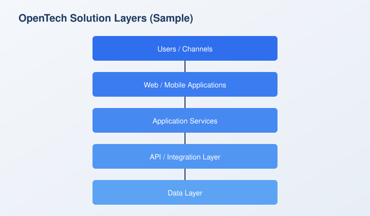

# Architecture Supporting Artifacts

**Document ID:** ARC-002
**Status:** Active
**Version:** 1.0
**Last Updated:** 2026-10-12
**Owner:** Architecture

## 1. Purpose

This document demonstrates how OpenTech architecture standards may include supporting artifacts such as diagrams, workbooks, and PDF checklists alongside the Markdown source.

## 2. Diagrams and Images

Architecture documents should embed diagrams that clarify solution structure. The sample below shows the standard OpenTech solution layers.

## 3. Capacity Workbook (Excel)

Where capacity or sizing assumptions are required, attach a workbook that reviewers can download and reuse.

- [Download capacity model (Excel)](assets/arc-002-capacity-model.xlsx)

The sample workbook includes illustrative peak request rates and instance counts by layer.

## 4. Checklist (PDF)

Formal checklists and printable reference material may be published as PDF attachments.

- [Download architecture checklist (PDF)](assets/arc-002-architecture-checklist.pdf)

## 5. Guidance

When attaching supporting artifacts to an architecture standard:

* Prefer source-controlled files under the same domain folder as the document
* Embed images inline so the published site shows the diagram without a separate download
* Link Excel and PDF files with clear download labels
* Keep artifact filenames stable so existing links do not break across minor document revisions

## 6. Review

Supporting artifacts must be kept consistent with the approved standard. Material changes to diagrams, workbooks, or checklists should be reviewed with the document owner before publication.
